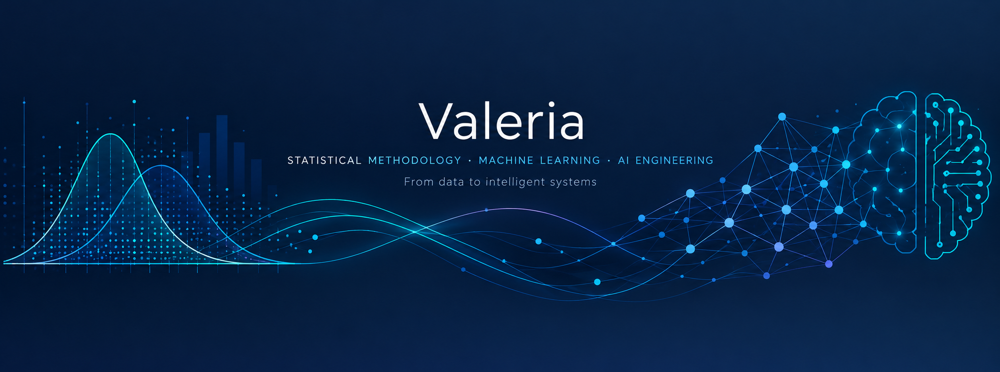

  

# Hola!! Soy Valeria 👋

Mi trayectoria parte de la **metodología y la estadística aplicada**, una base desde la que he ido orientando mi perfil hacia el desarrollo, la evaluación y la aplicación de modelos de Machine Learning.

Me interesa conectar el rigor del análisis estadístico con la capacidad predictiva de los algoritmos de aprendizaje automático, avanzando desde los métodos clásicos de modelado hacia arquitecturas de Deep Learning y sistemas de inteligencia artificial.

Actualmente estoy ampliando esta trayectoria con dos formaciones de máster: una orientada a la **ingeniería de automatización con IA agéntica** y otra a la **ingeniería de datos**.

## 🧭 Áreas de conocimiento e interés

### 📊 Estadística aplicada y metodología
Fundamentos metodológicos para el análisis de datos, la evaluación de modelos y la interpretación de resultados, prestando atención a los supuestos, la incertidumbre y la validez de las conclusiones.

### 🤖 Machine Learning
Aprendizaje supervisado y no supervisado, con especial interés en:

- Clasificación y regresión.
- Clustering y aprendizaje basado en patrones.
- Métodos de ensemble y algoritmos avanzados.
- Selección, evaluación y comparación de modelos.

### 📈 Series temporales y forecasting
Modelos clásicos de previsión y métodos basados en aprendizaje automático para el análisis de patrones temporales y la generación de predicciones.

### 🧠 Deep Learning
Exploración de distintas arquitecturas de redes neuronales:

- **CNN:** redes neuronales convolucionales y visión artificial.
- **RNN, LSTM y GRU:** modelado de secuencias y datos temporales.
- **Transformers:** arquitecturas basadas en mecanismos de atención.
- **Modelos generativos:** aprendizaje de representaciones y generación de contenido.

### ⚙️ Ingeniería de IA y datos
Interés en la integración de modelos dentro de sistemas tecnológicos, combinando ingeniería de datos, automatización e IA agéntica.

## 🎓 Formación actual

- Máster en Ingeniería de Automatización con IA Agéntica.
- Máster en Ingeniería de Datos.

Mi formación previa en metodología de las ciencias del comportamiento y de la salud constituye la base estadística y analítica desde la que desarrollo mi perfil tecnológico.

## 🛠️ Tecnologías

- **Lenguaje:** Python.
- **Deep Learning:** TensorFlow y Keras.
- **Modelado:** Machine Learning y redes neuronales.
- **Herramientas:** Jupyter Notebook y Git/GitHub.

*Esta sección recoge las herramientas utilizadas en mis proyectos; iré ampliándola a medida que avance mi formación.*

## 🚀 Proyectos destacados

### 👁️ Detección de glaucoma mediante transferencia de aprendizaje
Aplicación de VGG16 a la clasificación de imágenes de fondo de ojo, con evaluación en distintas bases de datos y exploración de interpretabilidad mediante Grad-CAM.

El proyecto permite estudiar tanto el rendimiento del modelo como sus limitaciones de generalización entre conjuntos de datos.

[Ver proyecto en GitHub](https://github.com/ValeriaBaz/deteccion-glaucoma-transferencia-aprendizaje)

### 🧠 Neural Networks Projects
Proyectos y experimentos con redes neuronales para tareas de regresión y modelado de secuencias, incluyendo arquitecturas MLP, RNN, LSTM y GRU.

[Ver repositorio](https://github.com/ValeriaBaz/Neural-Networks-Projects)

## 🌱 En constante evolución

Mi objetivo es seguir desarrollando una visión integral del ciclo de vida de los modelos: desde la comprensión de los datos y la selección del enfoque metodológico hasta el entrenamiento, la evaluación y su posible integración en sistemas de IA.

---

*Metodología y estadística como base; Machine Learning e ingeniería de IA como dirección.*
